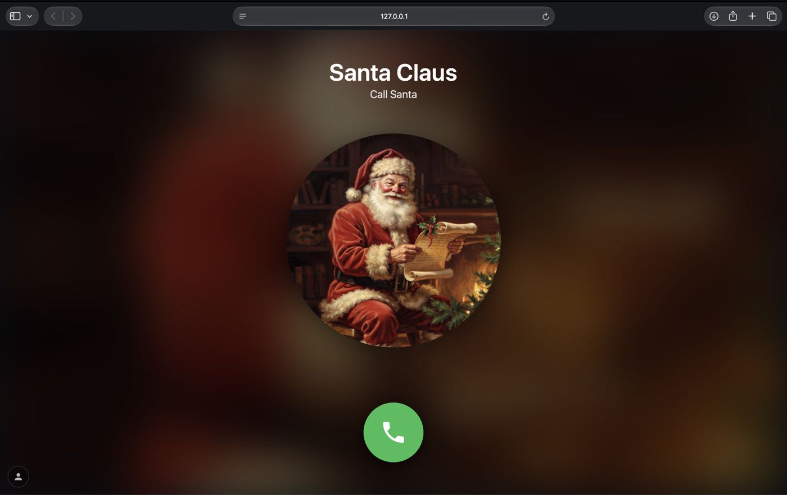

# Talking Santa



A talking Santa for young children, ages 2 to 5, that runs on one Mac. Speech recognition, the language model and the
voice all run locally, and an adult stays in the room for every call.

```
mic -> VAD -> STT -> [ Santa brain: persona + memory + safety ] -> TTS -> speaker
```

## Is this OK for my kids?

**Use at your own risk.** You are responsible for testing Santa's outputs to decide if this is appropriate for you.
Santa's words come from a language model, which can say things that are wrong, odd or unsuitable for a child, and no
filter catches everything. Talking Santa is provided "as is", without warranty of any kind, and the author is not
liable for anything Santa says or for any harm or loss from using it; the full terms are in the [LICENSE](LICENSE). It
is not a certified children's product and has not been independently tested for child safety. By using it, you accept
these terms, and you agree that an adult stays in the room for every call.

- **It is a hobby project.** One parent wrote it for young children, with an adult supervising every call. It is not
  a product, and it comes with no warranty (see [LICENSE](LICENSE)).
- **It runs on your Mac.** Speech recognition, the language model and the voice run on this Mac. Santa's own code makes
  no network calls except to the model server on this Mac (`localhost:12434` by default), and it keeps the
  speech-model loader offline however you start it, unless you set `HF_HUB_OFFLINE` yourself. If you point
  `SANTA_BASE_URL` at another computer, the children's words go there. Docker Desktop is separate software with its own
  settings.
- **The call page saves no audio and no transcripts.** It saves short facts about each registered child in
  `local/profiles.json`. The `--debug-audio` flag saves recordings, and the typed chat (`chat.py`) saves transcripts. See
  [Data and privacy](#data-and-privacy).
- **Everything Santa says is checked by a word-pattern filter before it is spoken.** For more information on how Santa
  was tested, and what was not, see [How Santa was tested](#how-santa-was-tested). The first line of defence is Santa's
  instructions (the persona prompt in `santa/persona.py`): never promise a specific gift, stay in character and never
  discuss being an AI or a computer with the children. The filter then removes sentences in known shapes: gift promises,
  repeating addresses or phone numbers, scary words, threats about the naughty list, and Santa saying he is an AI,
  robot, computer, chatbot or a named AI product. It lets him say he is not a computer. The filter is not exhaustive: it
  misses wording outside its patterns, and the known gaps are listed in CHANGELOG.md ("Known open items", "Accepted
  gaps") and pinned as tests. Measured once with the default model on 182 short conversations (one or two turns,
  `ai/gemma4:e4b`, persona v1) built to aim at those gaps, the model wrote 0 promise-like sentences and 0 AI-ish words.
  That is a small sample from one model, not a guarantee, which is why an adult stays in the room for every call.
- **Only this Mac can reach Santa by default.** `--network` adds HTTPS, a PIN, lockouts, a rate limit and a macOS alert
  with a Stop Santa button.
- **You can see and delete what Santa remembers.** Open `local/profiles.json` to see it. **Forget last** on the call
  page removes the facts from the last turn. Details: [Data and privacy](#data-and-privacy).

Known limits are listed under [Known limits](#known-limits).

## What you need

- An Apple silicon Mac (the voice app uses Apple's MLX for speech recognition).
- Python 3.12. The install below runs `python3.12`; if `python3.12 --version` says "command not found", install it
  with [Homebrew](https://brew.sh/): `brew install python@3.12`. A newer Python 3 may work in its place but is
  untested.
- [Docker Desktop](https://www.docker.com/products/docker-desktop/) with Model Runner (it serves the language model;
  step 3 below turns it on).
- The internet, once, for setup: pip, the Docker model pull and the model files. After that Santa runs without it.
- Tested on: Apple M5, 32 GB, macOS 27.0.1, Python 3.12.13. Other versions are untested.

## One-time install

One Python environment serves everything: the call page, the typed chat, the tests and the start script
(`scripts/start-santa.sh` looks for it at `~/.venvs/talking-santa-h`; `SANTA_PYTHON` points at another interpreter).
Run these from the repository folder, in this order.

```bash
# 1. The Python environment
python3.12 -m venv ~/.venvs/talking-santa-h
~/.venvs/talking-santa-h/bin/pip install -e ".[web,dev]"   # fastapi, uvicorn, onnxruntime, mlx-whisper, kokoro-onnx, test tools

# 2. The voice, voice-activity and speech-recognition files (they are loaded from disk afterwards)
M=~/.cache/talking-santa/models; mkdir -p $M
curl -L -o $M/kokoro-v1.0.onnx https://github.com/thewh1teagle/kokoro-onnx/releases/download/model-files-v1.0/kokoro-v1.0.onnx
curl -L -o $M/voices-v1.0.bin  https://github.com/thewh1teagle/kokoro-onnx/releases/download/model-files-v1.0/voices-v1.0.bin
curl -L -o $M/silero_vad.onnx  https://github.com/snakers4/silero-vad/raw/master/src/silero_vad/data/silero_vad.onnx
~/.venvs/talking-santa-h/bin/python -c "from huggingface_hub import snapshot_download as s; s('mlx-community/whisper-small.en-mlx')"

# 3. The language model: Docker Desktop > Settings > Model Runner > enable host-side TCP (port 12434), then
docker model pull ai/gemma4:e4b            # only ONE large model should be loaded at a time

# 4. Your personal folder (gitignored; see "Customize")
mkdir -p local && cp profiles.example.json local/profiles.json    # then edit it

# 5. Check that the model answers
source ~/.venvs/talking-santa-h/bin/activate
python scripts/check_model.py
```

`scripts/start-santa.sh` also checks that Model Runner answers and that the model is downloaded, and offers to fix both
(it asks first).

## Start and stop

```bash
scripts/start-santa.sh              # this Mac only: http://127.0.0.1:8765
scripts/start-santa.sh --network    # other devices on your network too (see "Use on your home network")
scripts/stop-santa.sh               # stops Santa, frees the model's memory
```

`start-santa.sh` checks Docker, Model Runner, the model, that no other model is using the memory, the voice setting
(and the Pocket TTS files, if you chose Pocket TTS) and, with `--network`, the PIN and certificates. For anything that
is off it asks "y/N" and fixes it, then starts Santa in the background and opens the page. It does not check the voice,
voice-activity and speech-recognition files from step 2 of the install. A missing voice or speech-recognition file
stops Santa at start, and the script prints the end of the log; a missing voice-activity file (`silero_vad.onnx`) only
shows when the page opens: the page cannot connect to Santa, and the log shows the error. The log is `local/run/santa.log`. `stop-santa.sh` stops what the start script started.

To run in a terminal instead: `scripts/run-web.sh` (add `--network` for the home network). It runs `python -m santa.web`
kept awake with `caffeinate` and passes any flags through; press **Ctrl+C** to stop it. **Hang up** on the page only
ends a call.

**If the model is not running:**
- The call page says "Santa is thinking… (this is taking a while)" and a grown-up note: "Santa's brain is slow to
  answer. If this keeps happening, restart the model runner."
- Santa says the fixed line "Santa is listening. Can you tell your grown-up too?" when no safe answer is available.
- `scripts/start-santa.sh` offers to start Docker Desktop, turn on Model Runner (port 12434), download the model, and
  unload other models. Loading two big models at once causes `Compute error` (Metal out of memory); run
  `docker model unload --all` before switching models.

## Using the call page

A FaceTime-style page on this Mac: a big green **Call**, a big red **Hang up**, a still Santa picture and a small
grown-ups strip (one button per registered child, **Guest**, **Forget last**). Open the address in your browser, allow
the microphone and press Call. The server listens on `127.0.0.1` only, unless you start it with `--network`.

- Every Call starts as **Guest**. Santa switches to a child when the child introduces themself with their registered
  name or nickname ("I'm Wren", "my name is Wren", "this is Wren", "it's Wren"; exactly one name, once), or when a
  grown-up presses that child's button. While no child is selected, a bare name also works ("Wren!", "Hi Santa,
  Wren"). A name that only appears in a sentence ("Wren, wait your turn.") does not switch, and nothing from a turn
  that names another registered child is saved.
- **Forget last** removes the facts Santa saved from the selected child's most recent turn; a second press does nothing.
  It does not remove older facts or the *Last call* line (see below); edit `local/profiles.json` for those.
- The **Timings** button shows per-turn latency (numbers only). `--verbose` logs the same numbers to the console.
- Children are read from `local/profiles.json` (register them once with `/add Name` in `chat.py`, or edit the file).

What Santa does, and how to change it (set values in `local/santa.env`; see [Customize](#customize)):
- **Voice:** Kokoro `am_michael` at 0.9 by default (`SANTA_VOICE`, `SANTA_SPEED`). A Kokoro blend is written as weighted
  names, e.g. `SANTA_VOICE=am_santa:70,bm_fable:30`. Kyutai Pocket TTS is an alternative voice that needs an extra
  install; see [Pocket TTS](#pocket-tts-optional).
- **Listening:** `SANTA_EOS_MS` (end-of-speech wait, default 1200), `SANTA_EOS_EXTEND=0` (turn off the one-time
  extension to 1800 ms for short turns), `SANTA_STT_MODEL` (default `mlx-community/whisper-small.en-mlx`).
- **Conversation arc** (asks each child's Christmas wish, then offers to say goodbye or to tell about the North Pole):
  off by default (`SANTA_ARC=0`); `SANTA_ARC=1` turns it on (experimental).
- **Gift question** (on by default): if gifts have not come up by a child's 5th turn, Santa is told to ask one
  Christmas-wish question. If the reply did not ask it, it is tried again on up to 2 more turns. Never while the child
  sounds sad (and for 2 turns after). `SANTA_GIFT_ASK=0` turns it off, `SANTA_GIFT_ASK_TURN` changes the turn. Off when
  `SANTA_ARC=1`. Guests share one slot. Code: `santa/gifts.py`.
- **Santa's backstory:** a fixed North Pole world (Mrs. Claus is Mary, the nine reindeer, four named elves) so he
  answers the same way every call. Replace it with your own in `local/santa_world.txt` (see `local.example/README.md`);
  the built-in text is `WORLD_DEFAULT` in `santa/persona.py`.
- **Last-call memory** (on by default): when a call ends with Hang up, or after a silence hang-up, Santa saves one short
  line per registered child who spoke at least twice, such as `Last call: told Santa about a new puppy and asked for a
  train`, so the next call can pick up where this one left off. It is built from the child's own words (sent to the
  local model), passes the same privacy checks as other saved facts, and each new one replaces the old one. No
  transcript is stored. It is not made if the connection simply drops. `SANTA_CALL_SUMMARY=0` turns it off; delete the
  line from `local/profiles.json` to forget it.
- **Time of day** (on by default): on the call's first turn and on goodbyes, Santa is told this Mac's time, so he says
  good morning, not good night, at 9 AM. `SANTA_TIME_NOTE=0` turns it off.
- **"Ho ho ho" once** (on by default): Santa laughs one big, slower "Ho, ho, ho!" when he answers the call. After that he
  says "Ho ho" only when the child sings or tells a joke. The prompt asks for this and the speech filter removes any
  other "Ho ho". `SANTA_HO_ONCE=0` turns it off. To change the laugh, edit `laugh`, `LAUGH_SPEED` and `LAUGH_PAUSE_S`
  in `santa/web/canned.py`.
- **Gentle mode** (on by default): when a child sounds sad or scared, Santa is told to comfort softly and to stay calm
  for that child's next 3 turns (no "Ho ho ho", no jokes). `SANTA_GENTLE=0` turns it off.
- **Songs** (on by default): Santa is told not to offer to sing. When a child asks for a song, Santa says the first
  verse of Jingle Bells or Deck the Halls (the one asked for, else taking turns) from fixed text, with no model call.
  The voice speaks the words; it cannot sing a tune. Asked for a song he does not know ("sing Frosty"), Santa says he
  doesn't know that one and offers one he knows; a yes on the child's next turn gets it. `SANTA_SONGS=0` turns it off.
  Code: `santa/songs.py`.
- **Output filter:** `SANTA_FILTER=legacy` switches to an alternative filter that repairs replies instead of only
  removing text (`santa/legacy/`). It is a fallback.

### Pocket TTS (optional)

Santa's default voice is Kokoro. Kyutai Pocket TTS is an alternative; the one-time install does not set it up. To try
it (needs the internet once):
```bash
source ~/.venvs/talking-santa-h/bin/activate
pip install pocket-tts==4.0.1                       # the version in requirements.lock; also installs torch
python tools/probes/j1_audition.py pocket-fetch     # downloads the model and the built-in English voices
```
Then set `SANTA_TTS=pocket` in `local/santa.env` and restart Santa. The default Pocket voice is `peter_yearsley`; any
built-in Pocket voice works in `SANTA_VOICE`; there is no speed setting. Santa loads it offline: it refuses to start
Pocket TTS unless `HF_HUB_OFFLINE=1`, which Santa sets by default.

## Use on your home network

`--network` lets other devices call Santa. It binds every network interface, so Santa is reachable from any network
this Mac is on (Wi-Fi, Ethernet, VPN): do not use it on untrusted networks. Browsers only allow the microphone over
HTTPS (or on this Mac's own address), so this needs a certificate your devices trust, made once with
[mkcert](https://github.com/FiloSottile/mkcert) (free, runs on this Mac, no account).

One-time setup on this Mac:
```bash
brew install mkcert            # add `brew install nss` if anyone uses Firefox
mkcert -install                # creates your private certificate authority (asks for your password once)
mkdir -p local/certs           # gitignored
mkcert -cert-file local/certs/santa.pem -key-file local/certs/santa-key.pem \
  "$(scutil --get LocalHostName).local" "$(ipconfig getifaddr en0)" localhost 127.0.0.1
```
`en0` is the Wi-Fi interface on many Macs; replace it with your Wi-Fi interface if yours differs.

On each phone or tablet, once: copy `rootCA.pem` from `mkcert -CAROOT` to the device (AirDrop works for iPhone and
iPad), install the profile, then on iOS turn it on in Settings > General > About > Certificate Trust Settings.
Never copy `rootCA-key.pem` anywhere.

Pick a PIN (at least 6 characters) and put it in `local/santa.env` (gitignored): `SANTA_PIN=<your PIN>`. Then:
```bash
scripts/start-santa.sh --network      # or: scripts/run-web.sh --network
# open https://<your Mac's name>.local:8765 on the other device (the startup message prints the address)
```
If macOS asks whether Python may accept incoming connections, choose Allow.

What changes in this mode:
- Other devices need the PIN: they see a PIN screen first. This Mac is never asked. After 5 wrong PINs, that device is
  locked out for 1 minute, then 5 minutes, then 30 minutes for each further 5 wrong tries. Restarting the server asks
  every device for the PIN again.
- PIN tries from devices that have not entered the PIN are limited to 10 a minute, all devices together
  (`SANTA_GATE_LIMIT`), and 5 from any one device, so one device cannot use them all up. The PIN page itself is never
  limited, so a family member is not slowed down; a PIN guesser using many addresses is.
- One call at a time (in every mode): a second page that presses Call hears nothing and sees "Santa is on another
  call". At most 4 Santa pages can be open at once.
- Security alert (macOS only, on by default in every mode; `SANTA_ALERTS=0` turns it off): a PIN lockout, the rate limit
  tripping, or a request for an unknown name pops up a dialog on this Mac with **Stop Santa** / **Keep Running**. It
  defaults to Keep Running and closes by itself after 5 minutes; Santa is never stopped automatically, so bad requests
  alone cannot end a child's call. At most one alert per 10 minutes. Nothing is sent off the Mac.
- `/status` (it lists the children's names) answers only on this Mac.
- If the Mac's network address changes, use the `.local` name, or re-run the `mkcert` line above.

In every mode the server only answers to its own names: `127.0.0.1` and `localhost`, plus, with `--network`, this
Mac's `.local` name and network address (read at startup). A request for any other name gets "unknown host". This stops
DNS rebinding, where a website you visit points its own name at your Mac to reach Santa. To use another name (say
a router DNS entry), add it to `local/santa.env`: `SANTA_ALLOWED_HOSTS=santa.home`.

## Customize

Everything here is optional. **Restart Santa after editing anything in `local/`** (settings, profiles, backstory,
picture): those files are read once, when Santa starts (`scripts/stop-santa.sh`, then `scripts/start-santa.sh`). The
page files under `santa/web/static/` only need a browser reload; Python changes need a restart.

**Settings.** Every setting, with its default and effect, is listed in [docs/configuration.md](docs/configuration.md).

**Your personal files go in `local/`.** Git ignores that folder, so your settings, PIN, picture, children's profiles
and certificates are never committed; the code only knows the file names. Template and details:
`local.example/README.md`. Settings go in `local/santa.env`, one `KEY=VALUE` per line (the common ones are in the
template `local.example/santa.env.example`; every setting is in [docs/configuration.md](docs/configuration.md)); a
value set in your shell wins.

**Santa's picture.** The call screen shows a painted Santa (`santa/web/static/santa-default.jpg`). To use your own picture, save
it as `local/santa.jpg` (or `.png` / `.webp`; square works best, for example 800x800) and restart Santa. Remove it and
restart to go back to the painting. The painting was made by the project owner with an AI image tool. No copyright is
claimed in it, and any rights the owner may have are waived under
[CC0 1.0](https://creativecommons.org/publicdomain/zero/1.0/), so it is free to use for any purpose. The MIT licence
covers the code, not this picture.

**Santa's name.** The name appears in two places, and you will usually want to change both:
- *On screen*, in `santa/web/static/index.html`: the big name on the call screen (`<div id="name">Santa Claus</div>`),
  the browser-tab `<title>`, the `Call Santa` button labels and the picture's `alt` text. In `santa/web/static/app.js`:
  the status line `SUB` (`Call Santa`) and the `Call Santa` button label; the listening and thinking labels are in
  `santa/web/static/callstatus.js`.
- *What Santa says*, in `santa/persona.py`: the first line of the system prompt (`You are Santa Claus, ...`) and the
  `I'm Santa ...` example. The fixed spoken lines are in `santa/web/canned.py` (the greeting and "didn't quite hear that")
  and `FALLBACK` in `santa/spec.py`. Changed canned lines are re-recorded in Santa's voice automatically the next time
  the server starts.

  The reply rules are tuned around Santa, so after renaming him run `pytest` and make a test call.

**Santa's personality.** Edit the prompt in `santa/persona.py`. Compare changes with `python evals/bench.py gen <model>` then `python evals/bench.py report` (see `evals/`).

**Santa's voice.** `SANTA_VOICE`, `SANTA_SPEED` and `SANTA_TTS` (see [Using the call page](#using-the-call-page)).

**The children.** Copy `profiles.example.json` to `local/profiles.json` and put your kids' names and ages in it (or
register them with `/add Name` in `chat.py`). A `profiles.json` in the repository folder still works until you move it.

*Making Santa more personal.* Santa reads four fields per child: `age`, `facts` (a list of short sentences),
`nicknames` (other names the child answers to) and `family` (what the child calls family members). Put what makes each
child special in `facts`: what they like, the town they live in, pets, favorite things. Other keys are kept in the file
but Santa ignores them. The example below uses made-up children and a made-up place:
```json
{
  "children": {
    "Pip": {
      "age": 4,
      "nicknames": ["Pipsqueak"],
      "family": {
        "mom": "Mama",
        "grandmother": ["Granny Fern"]
      },
      "facts": [
        "lives in Gumdrop Hollow",
        "has a toy dragon named Sparkle",
        "loves snow angels and drawing",
        "wants a drawing pad"
      ]
    }
  }
}
```
- Edit the file with Santa stopped (Santa saves to it during calls and would overwrite your edit). Check it with
  `python3 -m json.tool local/profiles.json`. A broken file falls back to `profiles.json.bak`, the last good save, and a
  copy of the broken file is kept as `profiles.json.corrupt`.
- Only the **last 8 facts** go into each turn, and Santa keeps at most **20** per child (oldest dropped first, including
  yours and the *Last call* line, which counts as one). Put the most important facts last, and check the file after a
  few calls.
- Facts you type by hand are not run through the safety filters that Santa's own saved facts get. Keep it to a town or
  state, never a street address, phone number or last name.
- Santa only mentions a child's facts when talking to that child: only the active child's facts are sent with each
  turn. Every child's name and age are always in the prompt.

**The model.** `SANTA_MODEL` (default `ai/gemma4:e4b`); `SANTA_BASE_URL` points at a different OpenAI-compatible server
(the children's words go to whatever server you name).

## Typed chat

`python chat.py` lets you type as the children (`Emma: hi santa`) with the same Santa, without voice.

```
/add Emma   register a child (Santa only remembers registered children)
/who        show remembered facts
/forget     wipe all memory, the backups and the saved transcripts
/quit
```

`chat.py` saves a transcript of every typed session to `local/transcripts/` when you quit (the full text of what was
typed and what Santa said), as long as the session had at least one reply. `/forget` deletes those files too.

## Data and privacy

What is written to disk, where and when:

| Situation | Written | Where | Contains |
|---|---|---|---|
| Call page (default) | `profiles.json`, rewritten after each turn of a registered child, on Forget last and at Hang up; `profiles.json.bak` (the previous good file); `profiles.json.tmp` while writing. Guests are never saved. | `local/` | Names, ages, nicknames, family names, short fact sentences, the `Last call:` line |
| Call page, first start for a voice setting | Canned-line audio (`*.npy`) | `santa/web/.cache/` (gitignored) | Santa's fixed lines only |
| Call page (default) | No audio, no transcripts, no log file | - | - |
| Started with `scripts/start-santa.sh` | `santa.log` (private to you), `server.pid` | `local/run/` | Warnings, start-up lines, model errors, alert reasons, and why a call's connection ended (state names and numbers) |
| `--debug-audio` | One `.wav` per child utterance, before recognition | `santa/web/debug_audio/` (gitignored) | **The children's voices** |
| `--metrics-file PATH` | One line of numbers per turn | `PATH` | Timings, counters, reason codes; no text |
| A `profiles.json` that cannot be read | `profiles.json.corrupt`, a copy of the broken file | next to the profiles file | Whatever was in it |
| `chat.py` | `<time>.txt` per typed session, at quit | `local/transcripts/` | **The full typed conversation** |
| In memory only, during a call | The conversation so far and the child's lines for the *Last call* summary | - | Dropped when the next Call starts |
| Outside this project | Docker Desktop and Model Runner keep their own logs and settings; Hugging Face keeps a model cache in `~/.cache/huggingface` | - | Not controlled by this project |

Logs hold timings, counters and reason codes, not speech. `/status` also lists the children's names, so it answers only
on this Mac.

**See it, delete it:**
1. *See what Santa remembers:* open `local/profiles.json` (or run `python chat.py` and type `/who`).
2. *Delete some of it:* press **Forget last** on the call page for the last turn's facts. For anything else (older
   facts, the *Last call* line) stop Santa, edit `local/profiles.json`, and delete `profiles.json.bak` and
   `profiles.json.corrupt` if present, since they hold earlier copies.
3. *Delete everything:* type `/forget` in `chat.py` (profiles, backups and transcripts), or delete the files in
   `local/` yourself, plus `santa/web/debug_audio/` if you ever used `--debug-audio`.

## Failure behavior

Numbers are the defaults in the code.

| Situation | What happens | Numbers |
|---|---|---|
| The model hangs or errors | Santa says the fixed fallback line; no retry | request timeout 15 s (`SANTA_TIMEOUT`) |
| A safety rule stops an answer after Santa has started speaking | Santa ends with the fixed fallback line, which asks the child to tell a grown-up | - |
| The model may have been unloaded | Santa warms it up first if the last good answer is older than 300 s, unless a warm-up failed less than 90 s ago | warm-up timeout 90 s |
| The answer is slow | After 10 s with no first sentence Santa says "Hmm, let me think about that." (at most once per 60 s in a call); the page shows "taking a while" | `SANTA_SLOW_S` 10, `SANTA_HOLD_EVERY_S` 60 |
| Hang up while waiting | No request is sent if the model has not been asked yet; a running answer stops at the next chunk | - |
| The connection to the page is lost | The server sends a tick every 2.5 s during a call; the page ends the call after 6 s with nothing received ("Lost connection to Santa") and reconnects. A dropped connection ends the call without a goodbye and without a *Last call* line. The log says why (see below). | `SANTA_TICK_S` 2.5 |
| Silence | After 45 s of no voice: "I'm still here. Take your time."; after another 45 s: goodbye and hang up | `SANTA_SILENCE_S` 45 |
| Speech Santa cannot make out | "Hmm, Santa didn't quite hear that. Can you say it again?" | - |
| Idle between calls | A small warm-up request every 100 s keeps the model loaded | `SANTA_KEEPALIVE_S` 100 |

**If the page says "Lost connection to Santa":** look in `local/run/santa.log` (or the terminal, if you started with
`scripts/run-web.sh`) for these warnings. They hold state names and numbers only, no speech.
- `connection closed during a call (close code N): state=... call_s=... turns=... page_silent_s=... server_up_h=...`:
  the page's socket closed mid-call. Code `4000` means the page's own watchdog gave up; `1001` is a closed or reloaded
  tab; `1006` is a connection that dropped. `page_silent_s` is how long the page had been quiet, `server_up_h` how long
  Santa had been running, `model_ok_s` how long ago the model last answered.
- `the page gave up on the connection: nothing received for N ms; its checks ran up to M ms apart; tab visible|hidden`:
  sent by the page after it reconnects. If M is much larger than 1000, the page itself was busy or throttled (a
  background tab, a slow Mac); if it is near 1000, nothing arrived from the server.
- `a liveness tick was N s late` and `sending a liveness tick took N s`: the server was busy, or the page was not
  reading. Either one can make the page give up.
- `sending to the page failed (...)`: a send failed because the connection was already gone.

The page also writes the same numbers to the browser console (Cmd+Option+J in Chrome). `--verbose` adds one line when a
call starts and one when it ends (with the reason).

## Known limits

- The safety filter removes known patterns only and is not exhaustive (known gaps: CHANGELOG.md, "Known open
  items"). The persona prompt is the first line of defence; an adult stays in the room for every call.
- Santa can mix up children: any voice near the microphone (a grown-up, a television, two children at once) is
  taken as the active child's turn.
- Speech recognition on children's voices is not measured.
- Sad facts can still be stored; use Forget last or edit the file.
- Forget last does not remove the *Last call* line, older facts or hand-typed facts.
- Guests share one gift and gentle-mode slot.
- Some behaviors are prompt instructions the filter does not enforce (comforting wording, "no jokes", not offering
  songs); only "Ho ho" is enforced.

## How Santa was tested

The author did all of this testing on one Mac (Apple M5, 32 GB). The results are for the default model,
`ai/gemma4:e4b`; if you choose another model (`SANTA_MODEL`), they do not apply to it.

1. **Choosing the model.** Six models were compared on 20 single-turn cases, 4 multi-turn conversations and 6
   memory cases, three samples each. The single-turn cases cover everyday chat; remembering a child's pet; wish lists
   and an expensive toy (Santa must not promise a gift); sad and scary topics (a goldfish that died, missing a
   grandpa, fear of the dark, the naughty list); "are you real?", "you're a fake", "are you a computer?" and an
   attempt to make him drop his rules; rude or nonsense words; and a child saying their street address (Santa must not
   repeat it). The conversations check that one child's facts never reach another child, that Santa holds up under
   repeated pushes to admit being an AI, and that memory works over 10 turns. Every reply was checked against the reply
   rules before any filtering, and rated 1 to 5 for warmth, age fit, responsiveness, magic and care by a second
   language model acting as a judge (not by people). With the default model, 97.7 to 99.2% of replies broke no rule
   even before the filter. Details: [docs/model-selection.md](docs/model-selection.md).
2. **Aiming at the filter's known gaps.** 182 short conversations (one or two turns) built to provoke the gaps listed
   under "Accepted gaps" in [CHANGELOG.md](CHANGELOG.md): 100 gift requests for toys not on the filter's gift list, 44
   claims such as "You promised me a pony!", 18 with a wish list and a letter in Santa's memory, and 20 direct "are you
   real / a robot / a computer?" questions. The model wrote 0 promise-like sentences and 0 AI-ish words. This was one
   run of one model, and the "I am... an AI." shape was not tried.
3. **Automated tests, run after every change.** More than 1,900 tests run without the model (`pytest`, see [For
   developers](#for-developers)). They include example sentences for every safety rule; 1,056 stored model replies from
   seven model setups, re-checked so that a sentence the filter blocks is never spoken; every known gap kept as a test
   that is expected to fail, so a change that fixes one is noticed and the list stays current; timing tests for the
   sentence shapes known to slow the filter down; memory rules (addresses, phone numbers, last names and
   instruction-like facts are not saved); and the home-network protections listed in [SECURITY.md](SECURITY.md).

**Not tested:** speech recognition on children's voices has not been measured; no outside expert or reviewer has
assessed Santa for child safety; the judge scores come from a language model, not from people.

**Test it yourself first.** `python chat.py` lets you type as a child and read exactly what Santa would say, through
the same filter, before your children hear him.

## Security

Built for small children, so privacy and safety come first. The short version; details are in
[SECURITY.md](SECURITY.md).

- **Private by default.** Speech recognition, the language model and the voice run on this Mac; see
  [Is this OK for my kids?](#is-this-ok-for-my-kids).
- **Local only unless you choose otherwise.** The server listens on `127.0.0.1`. `--network` adds HTTPS, a PIN,
  escalating lockouts, a rate limit and a macOS alert with a Stop Santa button.
- **Protections** against DNS rebinding, cross-site WebSocket hijacking, clickjacking, PIN brute force, prompt
  injection through stored memories, and request-flooding denial of service. Most protections have regression tests.
  The safety patterns have timing tests for the shapes known to be slow.
- **Checked.** A pre-commit hook (install it with `scripts/install-git-hooks.sh`) blocks private files and secrets; it
  can be skipped with `git commit --no-verify`. `scripts/security-scan.sh` runs gitleaks, pip-audit (on
  `requirements.txt` and on `requirements.lock`, the versions that actually run), Snyk, bandit, Semgrep and Trivy; tools
  that are not installed are skipped, and only a pip-audit failure fails the run. The dependency scan only covers
  published Python package advisories; see SECURITY.md for what it cannot see. An AI-assisted review (VulnHunter) on
  2026-11-10 found issues; the CHANGELOG lists each one that was fixed.

Found a security problem? Please report it privately; see [SECURITY.md](SECURITY.md). For bugs and ideas, see
[CONTRIBUTING.md](CONTRIBUTING.md).

## For developers

```bash
source ~/.venvs/talking-santa-h/bin/activate     # the environment from "One-time install"
pytest                                            # about a minute; no model server needed; Node.js is optional
```
Tests always use a fresh temporary `SANTA_LOCAL_DIR` and `SANTA_PROFILES`, whatever your shell exports. Two test files
also run JavaScript tests when Node.js is installed.

Layout:
- `santa/` - the core: `brain.py` (history + memory + reply, reused by the voice page), `persona.py` (system prompt),
  `spec.py` (every reply rule), `speech.py` (remove-only streaming filter), `safety.py` (wrapper for callers of the
  filter), `memory.py` (per-child facts in `local/profiles.json`), `local.py` (finds your files in `local/`),
  `config.py` (model and memory settings, read from the environment), plus `arc.py`, `cues.py`, `gifts.py`, `songs.py`
  - `santa/web/` - the call page: voice activity detection and end of speech, Whisper speech recognition, Kokoro
    voice, call state machine (uses the brain unchanged); the page itself is in `santa/web/static/`
  - `santa/legacy/` - the alternative output filter (`SANTA_FILTER=legacy`)
- `chat.py` - typed chat
- `profiles.example.json` - example children's profiles (made-up names); copy it to `local/profiles.json`
- `local.example/` - template for your personal `local/` folder
- `tests/` - pytest suites (`spec/`, `review/`)
- `evals/` - toddler scenario benchmark, which needs the model server: `bench.py` and `bench_all.sh` (the benchmark),
  `cases.json` (test cases), `personas/` (prompt variants), `results/` (raw results), `MANIFEST.json` (which code and
  prompt made the results), `bench_report.md` (the final comparison), and earlier reports kept for the record
  (`bench_report_run1_defaultctx.md`, `report-gemma4.md`, `report-ministral8b.md`). `python evals/bench.py gen <model>`
  overwrites the result files in `evals/results/`
- `tools/` - not run by pytest: `probes/` (probes, benchmarks and live smoke tests that need the model and/or voice
  stack running; outputs go to the gitignored `tools/probes/out/`), `review/` and `audit/` (one-off scripts
  behind the development notes in `docs/history/`)
- `scripts/` - `start-santa.sh`, `stop-santa.sh`, `run-web.sh`, `check_model.py` (smoke test), `install-git-hooks.sh` +
  `git-hooks/` (pre-commit hook), `security-scan.sh`
- `docs/` - `architecture.md` (how it fits together, with diagrams), `configuration.md` (every setting),
  `model-selection.md` (why Gemma 4 e4b: benchmark method, data, results), `images/` (the screenshot above);
  `docs/history/` - the development log (design notes, audit and review write-ups), a record rather than instructions
- `CHANGELOG.md` - what changed. `SECURITY.md` - security policy and threat model. `CONTRIBUTING.md` - how to report
  bugs and contribute. `LICENSE` - MIT
- `pyproject.toml` - the package and its dependencies (`pip install -e ".[web,dev]"`); `requirements.lock` - the exact
  versions that run (below); `requirements.txt` - the one core dependency, kept for the security scan and Dependabot
- `.github/` - issue and pull-request forms, Dependabot settings; `.gitignore` and `.semgrepignore` - what git and
  Semgrep skip; `.claude/` - settings for Claude Code users that keep it from reading private files

### Regenerate requirements.lock
`requirements.lock` is a `pip freeze` of the environment that actually runs Santa (web and voice stack included).
Regenerate it from that environment after any install or upgrade, then audit it:
```bash
~/.venvs/talking-santa-h/bin/python -m pip freeze | grep -v -e "@ file://" -e "^-e" > requirements.lock
pip-audit -r requirements.lock --no-deps --disable-pip
```
It is a record for auditing, not an install recipe: some pins (torch, mlx) are platform-specific (Apple silicon).

## Models

The four default models and the optional Pocket TTS voice are open-weight models that run on this Mac. Each
model's own page has its terms.

| Role | Model | Developer | Source |
|---|---|---|---|
| Language model | Gemma 4 e4b, served by Docker Model Runner (the file comes from Docker's `ai/gemma4`) | Google DeepMind | [Google's model card](https://ai.google.dev/gemma/docs/core/model_card_4) |
| Speech recognition | Whisper small.en via mlx-whisper (the `mlx-community/whisper-small.en-mlx` conversion) | OpenAI | [openai/whisper](https://github.com/openai/whisper), [conversion](https://huggingface.co/mlx-community/whisper-small.en-mlx) |
| Voice | Kokoro-82M v1.0 via kokoro-onnx | hexgrad | [hexgrad/Kokoro-82M](https://huggingface.co/hexgrad/Kokoro-82M) |
| Voice activity | Silero VAD v5 | Silero team | [snakers4/silero-vad](https://github.com/snakers4/silero-vad) |
| Voice, optional instead of Kokoro (`SANTA_TTS=pocket`; see [Pocket TTS](#pocket-tts-optional)) | Pocket TTS | Kyutai | [kyutai-labs/pocket-tts](https://github.com/kyutai-labs/pocket-tts) |

License: see each model's page. For Gemma 4, Google's model card lists Apache 2.0. Why Gemma 4 e4b and how the
candidates were compared: [docs/model-selection.md](docs/model-selection.md).

## Prior art (none is local + multi-child)

- unconv/santa-gpt - web app, OpenAI STT/LLM/TTS
- jordicor/santa-claus-is-calling - Santa phone calls via cloud APIs; prompt-injection ideas worth reading
- ArvinZhuang/local-her - local speech-to-speech tuned for Apple Silicon (a reference for the voice page)
- shivu0070/local-voice-ai - Whisper + Ollama + Piper pipeline
