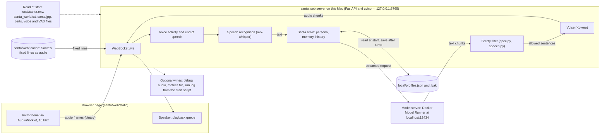
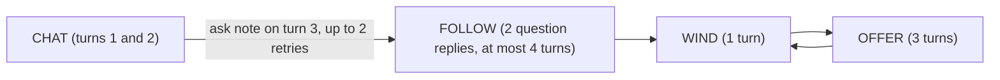
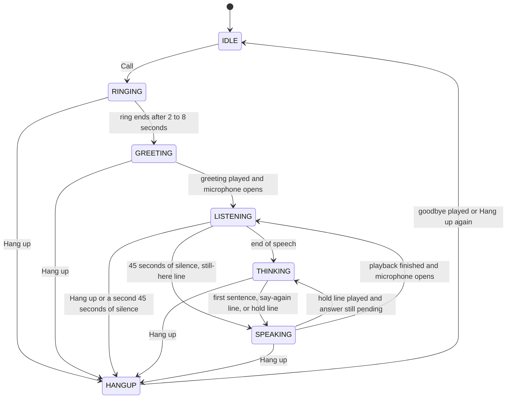
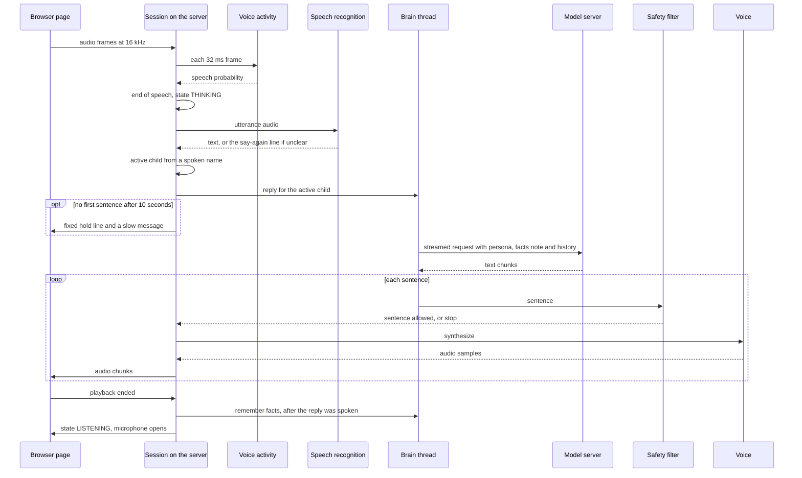

# Talking Santa: architecture

How the call page and the Santa brain fit together, what is stored, and where the safety checks sit. Keep this file about
what the code does today; what changed is in `CHANGELOG.md`. Settings are in [configuration.md](configuration.md), what
is written to disk is in the README's [Data and privacy](../README.md#data-and-privacy) table, and the user-facing
behavior is in the [README](../README.md). Do not put children's names or any profile data here.

## 1. Purpose and constraints

- A talking Santa for young children, ages 2 to 5, that runs on one Mac, always used with an adult in the room.
- Hard constraints: Santa's own code makes no network calls at runtime except to the model server on the same Mac;
  child safety before everything else; Santa must not feel slow. The models are open-weight models that run locally.
- Non-goals: cloud use, accounts, barge-in (talking over Santa), and exposing the server to the internet (do not forward
  its port). Home-network use is opt-in (`--network`).

## 2. System overview

The browser sends the microphone as 16 kHz audio over one WebSocket. On the server, voice activity detection finds the
end of each turn, speech recognition turns it into text, and the Santa brain builds a prompt from the persona, the
active child's remembered facts and the recent conversation. The prompt goes to the model server on this Mac, which
streams text back. A safety filter checks the text sentence by sentence; only allowed sentences reach the voice, whose
audio goes back over the WebSocket to the page. Santa's fixed lines (greeting, goodbye and so on) are played from a
small audio cache. Profiles are read when Santa starts and saved after turns. Settings, the backstory, the picture,
certificates and the voice files are read from disk when Santa starts; the optional writes are described in the README.

- Processes and ports: the browser page; the `santa.web` server (FastAPI and uvicorn, `127.0.0.1:8765` unless started
  with `--network`); Docker Model Runner serving the language model on `localhost:12434`.
- Only one large model is loaded at a time (the language model). Speech recognition, the voice and voice activity
  detection are small and run in the server process: speech recognition, the voice and the brain each have one worker
  thread (`Workers` in `session.py`); voice activity detection runs on the event loop.

## 3. Components

### 3.1 Santa brain (`santa/`)
| File | Role |
|---|---|
| `brain.py` | history + memory + reply; `reply_stream`, `reply_ex`, `remember`, `warm_up`, `end_call` |
| `persona.py` | system prompt (edit here to tune Santa); facts note and conversation-arc note wordings |
| `arc.py` | conversation arc: per-child stage machine that picks a short note for the current turn (pure logic) |
| `gifts.py`, `songs.py`, `cues.py` | gift question, song requests, small word checks on what the child just said |
| `spec.py` | the one place where reply rules live: pure functions, no I/O |
| `speech.py` | remove-only, prefix-only streaming filter, sentence by sentence |
| `safety.py` | thin wrapper over `spec.py` and `speech.py` for callers of the filter |
| `memory.py` | per-child facts in `local/profiles.json` (text only) |
| `local.py` | finds your files in `local/` |
| `config.py` | central config, overridable by environment variables |

**Prompt layout.** The system prompt is the same for the whole call: the persona, every registered child's name and
age (no facts), and the backstory. The active child's facts, the time-of-day note and any gift, gentle or arc note go on
the current user turn only and are never stored in history. History is trimmed in blocks so the start of the prompt stays
identical for several turns. This keeps the model server's prompt cache useful, which is what keeps the first word fast
(`brain.py` module docstring, `config.py` history settings).

**Memory after the reply.** `remember()` makes a second model call to extract facts. It runs on the brain thread after
Santa has finished speaking (`session.py`, after playback), so it never delays an answer.

#### Conversation arc
When switched on (`SANTA_ARC=1`), Santa steers each child's conversation: chat, ask once what the child would like for Christmas, ask a couple more
questions, then offer to say goodbye. If the child wants to stay, he offers topics (talk more, the North Pole, the
reindeer, the elves) and later winds down again. He never ends the call: the grown-up does (Hang up).

The arc goes from CHAT to FOLLOW once a reply has asked the Christmas question (or after the retries), from FOLLOW to
WIND after two question replies or four turns, from WIND to OFFER after one turn, and from OFFER back to WIND after
three turns (`santa/arc.py` constants).

- `santa/arc.py` keeps the state per registered child, per conversation: turns, stage, whether the Christmas
  question was asked, follow-up count, turns in the current stage. A new conversation (every Call) starts fresh,
  because the web app makes a new `Santa` per Call.
- Each turn gets at most one short note (wordings in `persona.py`), added to the **current user turn only**, after
  the facts note. It is never stored in history and never in the system prompt, so the prompt cache still works.
- The state moves on only when something was actually spoken (never on the fallback line), using the spoken text:
  "asked" means the reply has a "?" and the word "Christmas"; a follow-up is a reply with a "?".
- Every note ends with the same two safety clauses: if the child says goodbye, say a warm goodbye and ask nothing;
  if the child sounded sad or scared, comfort them and ask nothing this turn.
- Guests and unregistered speakers get no arc and no note. The arc follows whichever child is active.
- **Off by default.** Neither note wording passed every live check of the arc (`docs/history/STAGE_I.md`), so
  `SANTA_ARC` defaults to 0 (no note, no state). `SANTA_ARC=1` turns it on.

### 3.2 Reply rules and safety model
- SAFETY rules are enforced: a sentence that trips one is never spoken, and nothing after it is.
- SHAPE rules are measured, not enforced by rewriting; the only one that acts is the hard length cap (45 words, 3
  sentences after an optional opening laugh), and it stops at a sentence boundary. A first sentence over 45 words cannot
  be cut, so Santa says the fallback line.
- The filter only removes text. It adds nothing except a fixed fallback line ("Santa is listening. Can you tell your
  grown-up too?") when nothing safe is left, or after the sentences already spoken when a SAFETY rule stops a reply
  partway (not when the length cap stops it), so the child is never left with only a cut-off start. It also removes a repeated "Ho ho" and turns markup characters into spaces
  before the voice.
- Only text that passed the speech filter, or a fixed line checked against the same rules, reaches the voice
  (`santa/web/safe.py`).
- **What the SAFETY rules cover (categories only):** gift promises (many shapes, including a pronoun after a gift request
  and the child's name), threats about the naughty list, repeating addresses or phone numbers, scary words, and Santa
  claiming to be an AI, robot, computer, chatbot or a named AI product. Santa is told to stay in character and not
  discuss being an AI or a computer with the children; the filter lets him say he is not a computer and does not catch
  every phrasing.
- The rules are word patterns. Timing tests cover the shapes known to be slow (`tests/spec/test_regex_timing.py`).

**Every path to the voice:**

| Path | Checked by |
|---|---|
| Model sentences | `speech.Gate` (rules, length cap, "Ho ho" removal), then the voice's tripwire |
| Fallback line | The voice's tripwire; if the tripwire fires, the line is checked as a fixed line first |
| Laugh and greeting, "say that again", "I'm still here", goodbye, hold line | Checked against the same rules when `santa/web/canned.py` is imported, rendered once, then the tripwire |
| Songs and song offers | The rules, line by line (no length cap or "Ho ho" removal), then the tripwire |
| `SANTA_FILTER=legacy` | The alternative filter (`santa/legacy/`), which repairs a whole reply instead of only removing text, then the tripwire |

The tripwire is `assert_speakable` in `santa/web/safe.py`: the voice refuses anything that was not approved by one of the
paths above and anything the rules flag.

**What the filter does not do:** judge meaning or tone; catch wording outside its patterns; stop Santa from *asking* for
private details (only the prompt forbids it); enforce prompt-only rules (comforting wording, "no jokes", not offering
songs, how many questions); check facts typed by hand. The child's own words are not filtered for speech, but addresses
and phone numbers in them are replaced before the model sees them and are never saved. An adult should be nearby.

### 3.3 Memory
- **Stored** in `local/profiles.json` (text only): per child, `age`, `facts`, `nicknames`, `family`, and at most one
  `Last call:` line. Guests are never saved.
- **Extraction:** after Santa has spoken, one model call sees only the child's own words and returns at most 2 facts
  (`FACTS_PROMPT` in `persona.py`). A fact is kept only if it is a single line of at most 100 characters, not private
  (address, phone, digits, last name), not instruction-like (a keyword check), and not a near-duplicate. At most 20 facts
  per child, oldest dropped. Nothing is saved for a turn whose words were redacted as private or when the model gave no
  answer.
- **Last call:** at Hang up (and after a silence hang-up), one line per registered child who spoke at least twice, made
  by the model from the child's words and checked like any fact. It replaces the previous one. It is not made when the
  connection drops.
- **What the prompt receives:** every child's name and age in the system prompt, and the **active child's** last 8 facts,
  nicknames and family names on the current turn.
- **Isolation** is therefore by prompt: another child's facts are not sent. It depends on the active speaker being right
  (section 5).
- **Forget last** (`brain_adapter.py`) removes the facts the selected child's most recent turn added and saves twice so
  the `.bak` copy loses them too; a second press does nothing. It does not remove older facts, hand-typed facts or the
  `Last call:` line. If pressed while Santa is answering, that turn's facts are not saved at all.
- **Backups:** each save keeps the previous good file as `profiles.json.bak`; an unreadable file is copied to
  `profiles.json.corrupt` and the `.bak` is used. A fact removed by hand stays in those copies until overwritten.
- **Known limit:** sad facts can still be stored.

### 3.4 Voice web app (`santa/web/`)
| File | Role |
|---|---|
| `settings.py` | every tunable, overridable by environment variable |
| `audio.py`, `vad.py`, `endpoint.py` | frames, Silero VAD, end-of-speech logic |
| `stt.py` | mlx-whisper; "say that again" rules from confidence |
| `safe.py` | the only door to the voice |
| `tts.py`, `canned.py` | Kokoro (or Pocket TTS); cached canned lines |
| `brain_adapter.py` | wraps the brain; one brain thread; cancellable stream |
| `session.py` | call state machine, mic gating, per-turn metrics |
| `access.py`, `alerts.py` | Host/PIN/rate-limit checks; the macOS security alert |
| `server.py`, `__main__.py` | FastAPI app, `/ws` protocol, `/status`, keep-alive loop; entry point and flags |
| `static/` | page, playback queue, grown-ups strip, Timings overlay |

**WebSocket messages** (`server.py` module docstring):
- browser to server: `hello`, `call`, `hangup`, `set_child` (a name or null), `forget_last`, `playback_started` and
  `playback_ended` (with an id), `client_lost` (numbers only, sent once after the page reconnects when its own watchdog
  ended a call; the server logs it), and binary 16-bit little-endian PCM at 16 kHz mono.
- server to browser: `state` (with the active child and the children), `ring_start`, `ring_stop`, `stop_audio`,
  `audio_start` (id, sample rate) followed by binary audio and `audio_end`, `metrics` (numbers), `forgot`, `busy` (another
  page is on a call), `tick` (every `SANTA_TICK_S` during a call), and `slow` (once per turn after `SANTA_SLOW_S`, or
  while the ring's warm-up is still running).
- close code 4401: this device has not entered the PIN. Close code 1013: too many call pages are open (4). Close code
  4000: the page's watchdog gave up on the connection. The server logs a warning (state, call length, turns, uptime)
  for any close during a call.

## 4. Call lifecycle

The states are in `santa/web/session.py`. A Call starts from IDLE and rings while the model warms up. Santa then plays
the laugh and greeting and opens the microphone. After the child's turn ends, the page shows THINKING while the reply is
made, and SPEAKING while Santa talks; the microphone opens again afterwards. Hang up works from every state except IDLE
and plays a short goodbye; a second press during the goodbye stops it at once. If the WebSocket itself closes, the
session goes straight to IDLE without a goodbye or a `Last call:` line.

- Every Call resets the active child to Guest and starts a fresh conversation.
- Hang up stops all audio at once and cancels the model stream, then plays a short goodbye before returning to IDLE.
- The microphone is ignored while Santa speaks and for a short guard time after (`echo_guard_ms`, 300 ms).
- **Silence:** after 45 s without a voice while listening, Santa says "I'm still here. Take your time."; after another
  45 s he says goodbye and hangs up (a `Last call:` line is made). Any voice resets this.
- **Keep-alive:** between calls the server sends a small warm-up request to the model server whenever the model has not
  answered for 100 s, so it stays loaded. During a call it sends a tick every 2.5 s; the page ends the call if nothing arrives for 6 s.
- **Failure behavior** (model hang, slow answers, lost connection) is described in the README's
  [Failure behavior](../README.md#failure-behavior) table. Beyond that table: the ring waits for the warm-up for at most
  8 s and then tells the page it is slow; a turn that raises an error ends with the "say that again" line instead of
  leaving the call stuck in THINKING; clips shorter than 250 ms are dropped and never transcribed; a turn is ended
  at once after 20 s of speech.

**One turn:**

The page streams audio; the session runs each 32 ms frame through voice activity detection until the end-of-speech wait
passes, then sends the utterance to speech recognition. If the text is unclear the session plays the say-again line.
Otherwise it picks the active child (a spoken name, or the child a grown-up chose) and asks the brain for a reply on the
brain thread. The brain sends a streamed request to the model server and passes the chunks through the safety filter
sentence by sentence; each allowed sentence is voiced and sent to the page. If the answer is slow, the session plays a
fixed hold line. When the page reports the playback ended, the brain saves new facts and the microphone opens again.

## 5. Who is speaking
- Every Call starts as Guest. The active child changes when a transcript contains exactly one registered name (or
  nickname), once, as a whole word (`heard_name` in `session.py`), or when a grown-up presses a child's button or Guest.
- The turn is answered and remembered for the active child; Guests get no facts and nothing is saved.
- Known weakness: switching on any spoken name can attribute one child's words to another (for example when a child says
  a sibling's name, or a nickname is an ordinary word), which sends the wrong child's facts and saves facts to the wrong
  profile.

## 6. Data and privacy
- Stored: per-child text facts in `local/profiles.json` (gitignored). Audio is not stored and the call page keeps no
  transcripts unless `--debug-audio` is on; the typed chat (`chat.py`) does save transcripts. The full table is in the
  README's [Data and privacy](../README.md#data-and-privacy).
- Logs and `/status` hold numbers and reason codes; `/status` also lists the children's names, so in network mode it
  answers only on this Mac. `--debug-audio` is off by default.
- Network: `127.0.0.1` by default. `--network` binds every interface over HTTPS (mkcert) behind a PIN for non-loopback
  clients, one call at a time, and `/status` stays loopback-only (`santa/web/access.py`). In every mode the WebSocket
  rejects a browser Origin that is not this server and every request must use one of the server's own names (Host
  allowlist). Network mode trusts the client address for the "this Mac" PIN exemption, so **do not put a reverse proxy
  in front of it**: a proxy on this Mac would connect from loopback and skip the PIN.
- Downloads happen only during the one-time install. The entry point keeps the speech-model loader offline unless the
  owner's shell or `local/santa.env` sets `HF_HUB_OFFLINE` (`scripts/run-web.sh` always sets it itself).
- Personal files (settings and PIN, picture, backstory, profiles, transcripts, certificates, run log) live in the
  gitignored `local/` (`santa/local.py`). Never commit: anything in `local/`, profiles files and their `.bak`/`.corrupt`
  copies, transcripts, settings files with a PIN, debug audio and any recordings, keys and certificates, logs, local
  scratch notes, scan results, downloaded model files, and the voice cache in `santa/web/.cache/`. The pre-commit hook
  refuses private paths and secrets.

## 7. Models

All four are open-weight models that run on this Mac. Each model's own page has its terms.

| Role | Model | Developer | Source |
|---|---|---|---|
| Language model | Gemma 4 e4b, served by Docker Model Runner (the file comes from Docker's `ai/gemma4`) | Google DeepMind | [Google's model card](https://ai.google.dev/gemma/docs/core/model_card_4) |
| Speech recognition | Whisper small.en via mlx-whisper (the `mlx-community/whisper-small.en-mlx` conversion) | OpenAI | [openai/whisper](https://github.com/openai/whisper), [conversion](https://huggingface.co/mlx-community/whisper-small.en-mlx) |
| Voice | Kokoro-82M v1.0 via kokoro-onnx | hexgrad | [hexgrad/Kokoro-82M](https://huggingface.co/hexgrad/Kokoro-82M) |
| Voice activity | Silero VAD v5 | Silero team | [snakers4/silero-vad](https://github.com/snakers4/silero-vad) |

License: see each model's page. For Gemma 4, Google's model card lists Apache 2.0. Optionally, Kyutai Pocket TTS can
replace Kokoro (`SANTA_TTS=pocket`). Why Gemma 4 e4b and how the candidates were compared:
[model-selection.md](model-selection.md).

## 8. Configuration
Every setting, with its default and effect, is in [configuration.md](configuration.md).

## 9. Testing and evaluation
- `tests/spec` and `tests/review` are the automated suites (`pytest`, about a minute, no model server needed; the model
  client is faked; two test files also run JavaScript tests when Node.js is installed). Tests always use a fresh
  temporary `SANTA_LOCAL_DIR` and `SANTA_PROFILES`.
- `evals/` is the toddler scenario benchmark (`python evals/bench.py gen <model>`, `judge`, `report`, or
  `evals/bench_all.sh`). It needs the model server running; see [model-selection.md](model-selection.md).
- `tools/probes/` holds probes, benchmarks and live smoke tests; `tools/review/` and `tools/audit/` hold the one-off
  scripts behind the development notes in `docs/history/`. None of them run under pytest, and the probes need the model and/or voice
  stack running because they send real requests to the model server. Their outputs go to the gitignored
  `tools/probes/out/`.
- In `tools/probes/smoke_live.py`, **recall** means a child's own remembered fact comes back when the child asks what
  Santa remembers, and **leak** means another child's fact word appears in a reply, which fails the check.

## 10. Operations
- One large model at a time; run `docker model unload --all` before switching models.
- **Startup checklist** (what `scripts/start-santa.sh` checks, in order): the Python environment, the settings in
  `local/santa.env`, Docker Desktop, Model Runner answering at the model URL, the model downloaded, no other model loaded
  in memory, the voice setting (and the Pocket TTS files when `SANTA_TTS=pocket`), with `--network` the PIN and
  certificates, and that the port is free. For anything off it asks and fixes it. It does not check the Kokoro, Silero
  VAD or Whisper files. Kokoro and Whisper load when the server starts, so a missing one stops it and the script prints
  the end of the log; the Silero VAD model loads when a page connects (`server.py`, per WebSocket), so a missing file
  passes the start script and the page cannot connect.
- **Offline checklist:** the Kokoro model and voices, the Silero VAD file and the Whisper snapshot are on disk (see the
  README's one-time install), the language model is pulled, and Santa is started with a script or with
  `python -m santa.web` so the speech-model loader stays offline.

## 11. Known limitations
- Speech recognition on children's voices is not measured.
- Speaker selection by spoken name can attribute one child's words to another.
- The safety filter is pattern-based and can miss unusual wording; the gift-promise rules depend on recognizing the
  child's request, so a request in an unusual wording may not trigger the pronoun rules.
- Sad facts can still be stored.
- Network mode trusts the client address (see section 6).

## 12. Design decisions
- **Language model: Gemma 4 e4b** over Gemma 4 12B and 26B-A4B and Ministral 3 8B and 14B. It was the fastest to first
  token and followed the reply rules best; the larger models only won small amounts of judged warmth and magic.
  Evidence: [model-selection.md](model-selection.md), `docs/history/STAGE_A.md`.
- **Reply rules in one place, removing only.** All rules live in `spec.py` as pure functions with no I/O, and the
  streaming filter only removes text.
- **Memory after the reply.** Fact extraction is a second model call that runs after Santa has spoken, so it never
  delays an answer.
- **A web page instead of a USB handset.** The call is a page on the Mac (`CHANGELOG.md`).
- **Kokoro by default, Pocket TTS optional.** Both run locally; `SANTA_TTS` chooses.
